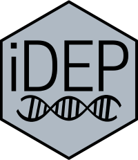

<div align="center">



# iDEP Desktop

[](https://github.com/orditus-llc/idep-desktop/releases/latest)
[](#install)

**Integrated Differential Expression & Pathway analysis, as a desktop app.**<br>
Analyze RNA-Seq, microarray, and proteomics data on your own computer. No R setup required.

**[Download page](https://orditus-llc.github.io/idep-desktop/)**

</div>

## Install

Download the file for your platform from the latest [release](https://github.com/orditus-llc/idep-desktop/releases).

| Platform | Est. install time | Download |
|---|---|---|
| Windows | 20-30 min | `iDEP-x.y.z-win-x64.exe` |
| Mac (Apple Silicon) | 10-15 min | `iDEP-x.y.z-mac-arm64.dmg` |
| Linux\* | 10-15 min | `idep-x.y.z-linux-amd64.deb` |

### \*Linux (tested on Ubuntu 24.04, x86_64)

1. **New install:** double-click the `.deb` file, or run the command below.<br>
   **Upgrading from an older version:** you must use the terminal. Ubuntu's App Center can't upgrade a downloaded `.deb` and will show "Installed" greyed out.
   ```console
   cd ~/Downloads
   sudo apt install ./idep-x.y.z-linux-amd64.deb
   ```
   The `cd ~/Downloads` line assumes the file is in your Downloads folder.
2. Launch iDEP from your application menu.

To uninstall:
```console
sudo dpkg -r idepgolem
sudo dpkg --purge idepgolem
```
The second command removes leftover configuration files.

## Release Notes

### Version 2.5.0
- Match Web iDEP Version to Avoid Confusion
- Ship pandoc in app to support rmarkdown generation

### Version 2.1.0
- Supports Windows, Linux, & **Mac**
- Database: data115
- Runs Web Version: 2.5.0

### Version 2.0.0
- Supports Windows & Linux
- Database: data113
